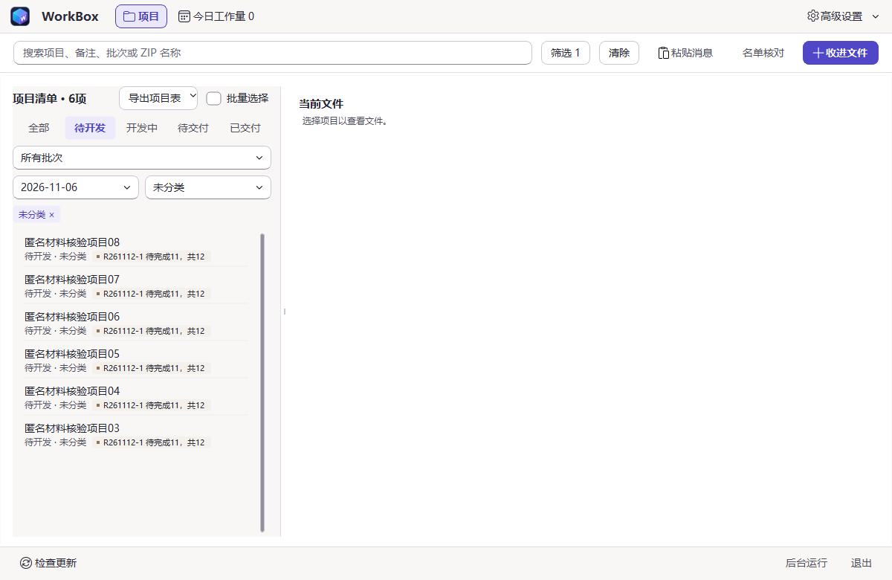

# WorkBox 工作箱

把收到的项目材料、当前文件和交付记录，整理在一个 Windows 工作台里。数据保存在本机，无需账号。

[下载 Windows 安装版](https://workbox.ltxiangzi.dpdns.org/#download) · [使用指南](https://workbox.ltxiangzi.dpdns.org/guide.html) · [更新记录](https://workbox.ltxiangzi.dpdns.org/releases.html)



*项目表导出功能的匿名源码界面，摄于 2026-11-12；安装包内容以对应发布记录为准。*

## 日常怎么用

| 你要做的事 | WorkBox 提供的入口 |
| --- | --- |
| 收进材料 | 拖入悬浮入口，或在工作台粘贴消息、选择文件；复制并校验，保留原件。 |
| 找到项目 | 按状态、类型、首次新增日期和批次组合筛选；重复收件不改变新增日期。 |
| 整理文件 | 项目内查看当前文件，旧稿单独保留；改名合并前先预览确认。 |
| 核对进度与交付 | 查看整批“待完成 / 共计”、交付明细与工作量；待交付和已交付不再计入待完成。 |
| 导出项目表 | 导出当前筛选结果或已勾选项目；另保留全部待开发项目的单列名单。 |

软件不读取聊天、不监听剪贴板、不上传桌面项目数据。Git 同步开发代码，不同步个人数据库和材料。

## 安装与更新

支持 Windows 10 1809+ / Windows 11 x64。安装版自带运行环境，尚无商业代码签名。

当前正式构建为 **2026-11-13 r1**，软件版本 **1.0.0**。[GitHub 备用下载](https://github.com/232577/workbox/releases/tag/v1.0.0.20261113.1)。

升级前备份 data、工作目录、归档目录及全部已登记历史文稿目录。已有安装可从“高级设置 → 检查更新”更新；遇到问题按[更新恢复说明](docs/UPDATE-RECOVERY.md)处理，保留原安装目录和数据。

<details>
<summary>当前安装包与校验信息</summary>

- 文件：`WorkBox-1.0.0-Setup-x64-20261113-r1.exe`
- 大小：42,422,935 字节
- SHA-256：`fb6c2b5f29df4af3b6858d79676d9e2cce2310b6f00e16971a78d190fa34c19d`
- 来源提交：`6278c1c3319468e4f0658e0cf1b086d756bd44d2`
- 验收范围以该 Release 的 `PUBLIC_BUILD_INFO.json` 为准。

</details>

历史安装包在[官网版本页](https://workbox.ltxiangzi.dpdns.org/releases.html)按需展开。完整[逐版说明](RELEASE_NOTES.md)和[历史公开说明存档](docs/releases/RELEASE-NOTES-ARCHIVE.md)保留供查证。

## 参与开发

技术栈为 Python 3.11、PySide6、SQLite 和 PyInstaller。多设备协作使用同一仓库、独立分支和 Pull Request，由检查通过的 main 产生正式构建；main 源码与当前安装包分别核对。

先读[协作指南](CONTRIBUTING.md)、[项目约定](AGENTS.md)和[接手地图](docs/PROJECT-TAKEOVER-2026-11-12.md)。安装依赖和分支流程见协作指南，构建与上线见[发布规程](docs/RELEASING.md)。

```powershell
.\.venv\Scripts\python.exe main.py --panel
.\.venv\Scripts\python.exe -m scripts.run_tests -q
node --test website/*.test.mjs
```

[验证范围](VERIFICATION.md) · [GPL-3.0-only 许可](LICENSE) · [第三方许可](THIRD_PARTY_NOTICES.md)
