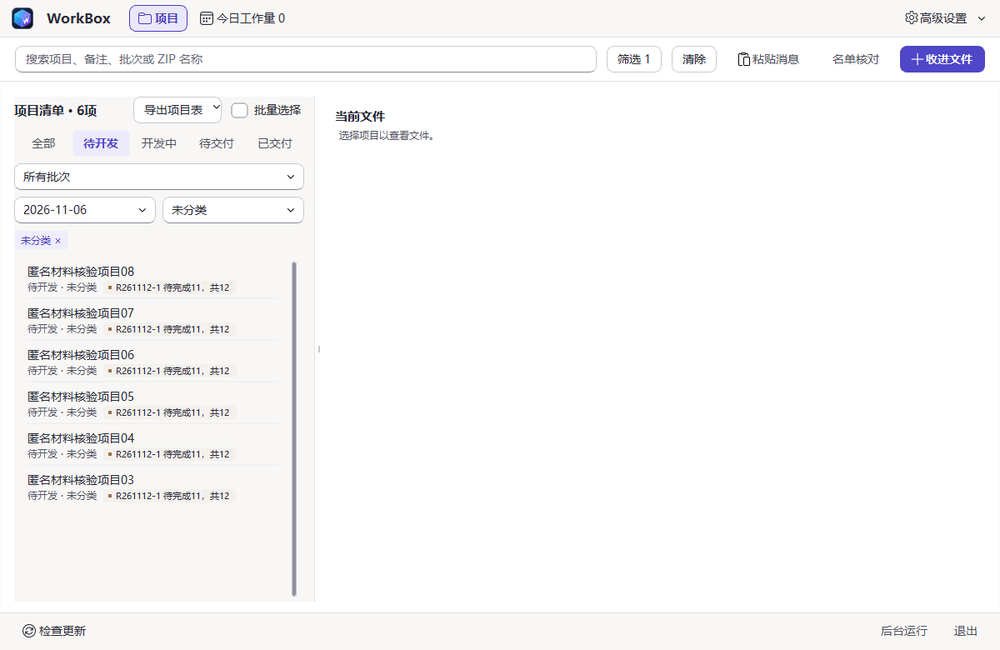

# WorkBox 工作箱

Windows 上的个人项目工作箱：收材料、找文件、核对交付。数据保存在本机，无需账号。

[下载 Windows 安装版](https://workbox.ltxiangzi.dpdns.org/#download) · [使用指南](https://workbox.ltxiangzi.dpdns.org/guide.html) · [更新记录](https://workbox.ltxiangzi.dpdns.org/releases.html)



*项目表导出功能的匿名源码界面，摄于 2026-11-12；安装包内容以对应发布记录为准。*

- **收好材料**：拖入消息、文件或文件夹，复制校验后归入项目，保留原件。
- **找到当前文件**：按状态、类型、日期和批次筛选；旧稿单独保留。
- **核对交付**：查看整批进度与交付记录，导出筛选结果或勾选项目。

## 安装与更新

支持 Windows 10 1809+ / Windows 11 x64，自带运行环境，未做商业代码签名。当前版本 **1.0.0**，正式构建 **2026-11-24 r1**。

升级前备份 data、工作目录、归档目录及全部已登记历史文稿目录，再从“高级设置 → 检查更新”操作。[安装指南](https://workbox.ltxiangzi.dpdns.org/guide.html#installation) · [更新恢复](docs/UPDATE-RECOVERY.md)

<details>
<summary>当前安装包与校验信息</summary>

[GitHub 备用下载](https://github.com/232577/workbox/releases/tag/v1.0.0.20261124.1)

- 文件：`WorkBox-1.0.0-Setup-x64-20261124-r1.exe`
- 大小：47,966,278 字节
- SHA-256：`19cf7076dc2ba0c18dc11d008c938fe6b14adc3c413b3d14769fd6b1309b6872`
- 来源提交：`72a0db4f5b7ddf73e38f9340cebcd392634b098d`
- 来源及载荷校验信息见该 Release 的 `BUILD_PROVENANCE.json` 与 `PACKAGE_CONTENTS.sha256`。构建验证范围见发布说明。

</details>

<details>
<summary>参与开发</summary>

技术栈为 Python 3.11、PySide6、SQLite 和 PyInstaller。Git 只同步代码，不同步个人数据和材料；正式构建来自审查通过的 main。

桌面源码位于 [`workbox/`](workbox/)。按职责查看[代码地图](docs/PROJECT-TAKEOVER-2026-11-12.md#代码地图)，按[协作指南](CONTRIBUTING.md)和[项目约定](AGENTS.md)开展开发。构建使用 [`scripts/build.ps1`](scripts/build.ps1)，见[发布规程](docs/RELEASING.md)。

```powershell
.\.venv\Scripts\python.exe -m workbox --panel
.\.venv\Scripts\python.exe -m scripts.run_tests -q
node --test website/*.test.mjs
```

[验证范围](VERIFICATION.md) · [逐版说明](RELEASE_NOTES.md) · [历史公开说明存档](docs/releases/RELEASE-NOTES-ARCHIVE.md)

</details>

软件不读取聊天、不监听剪贴板、不上传项目数据。[GPL-3.0-only 许可](LICENSE) · [第三方许可](THIRD_PARTY_NOTICES.md)
