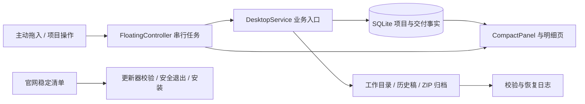

# WorkBox 接手地图与审查结果

审查日期：2026-11-12。开始基准为 `21d3e7eb58777b94eb74f2e53b63fef3bce6e098`；期间另一开发通道合并 [#89](https://github.com/232577/workbox/pull/89)，本轮已快进到 `284dda8773712e249ecd7edd741b7dcc9765b9dc`，补读增量并在该提交重跑四个缺陷探针。下文代码行号均按后者。

这是接手级架构梳理、风险审查及匿名故障复现，覆盖全部受控文件的清点、Python 语法解析、主要业务与发布链路；不等同于逐行形式化审计、全量性能测试或第二台物理设备验收。本轮只更新接手文档和过期产品说明，以下三个程序问题尚未修复。

## 先认识这个产品

WorkBox 是 Windows 项目材料与交付工作台：收进项目文字和材料，维护当前文件与历史稿，确认交付并查看批次进度及工作量。Python 3.11、PySide6 / Qt Widgets、SQLite、PyInstaller / Inno Setup 是现有技术基线；官网是独立 Cloudflare Worker 与静态页面。Git 同步开发代码，不同步用户项目、文件与数据库。

接手时必须分开四个身份：Git 提交、源码里的构建标签、实际安装 EXE、官网当前下载。软件名都显示 1.0.0，不能据此认定相同版本。`284dda8` 的源码含立方体品牌和悬浮尺寸设置；本轮没有把这次源码快进当作安装或发布完成。

主要规则必须保留：

- 状态只有待开发、开发中、待交付、已交付；加急、项目类型、工作量资格独立。批次“待完成”只计待开发和开发中。
- 收录复制并校验、保留原件；ZIP 不解压或执行。普通新稿保留标准名，旧稿转入已登记历史目录；交付只采用当前材料。
- 项目名/别名经规范身份匹配；歧义必须选择。改名与合并先预览、再明确确认，沿用原目录和历史身份。
- 交付事实与更正采用追加记录；首次有效交付按规范项目及北京时间计算。材料齐全、收录成功、交付完成和工作量是不同事实。
- 路径、内容或恢复状态不明确时应停止相应写入；未知不能当成零或成功。
- 已退役任务组保留后台兼容与历史数据；不因文件仍在而恢复旧页面。

## 代码地图

| 责任 | 入口与相关模块 | 接手时要理解的边界 |
| --- | --- | --- |
| 启动与应用组织 | `main.py`、`app.py`、`desktop_service.py`、`desktop_controller.py` | CLI / Qt 初始化、业务组合、单实例数据锁、串行任务与退出；活动主窗口是 CompactPanel |
| 项目和交付数据 | `database.py`、`task_schema.py`、`task_groups.py`、`project_batches.py` | SQLite/WAL、短连接、规范项目、追加交付事实；任务兼容不能增加原项目首交计数 |
| 名称与收件判断 | `parser.py`、`project_names.py`、`text_intake.py`、`file_matcher.py`、`zip_manager.py`、`bundle_analyzer.py`、`zip_content.py`、`folder_intake.py` | 普通文稿、ZIP、合包与目录分开处理；支持已有项目复用和显式歧义选择 |
| 文件与恢复 | `native_files.py`、`workspace_manager.py`、`document_versions.py`、`managed_archive.py`、`snapshot_manager.py`、`intake_log.py` | 文件身份、复制校验、历史轮换、稳定 ZIP 发现、恢复日志；不能绕过服务保护直接写文件 |
| 改名与合并 | `project_changes.py`、`project_directory_changes.py`、`project_change_ui.py` | 预览令牌、当前状态复核、目录恢复、合并后的历史身份 |
| 交付与分类 | `delivery_archive.py`、`archive_facts.py`、`archive_classification.py`、`delivery_export.py`、`workflow_policy.py` | 交付材料快照、事实解释、分类策略、只读导出；分类阈值不等于自动交付阈值 |
| 材料与名单 | `material_matching.py`、`material_check_store.py`、`checklist_reader.py`、`checklist_review.py`、`project_documents.py` | 纯匹配与规则、外部名单读取、当前文件视图；不凭名单自动建项或认定交付 |
| 当前业务页面 | `compact_ui.py`、`project_documents_ui.py`、`delivery_ui.py`、`material_check_ui.py`、`checklist_ui.py`、`archive_classification_ui.py`、`project_types_ui.py`、`export_ui.py` | 主清单、文件、交付、核对与设置入口；各后台读取的取消和过期结果处理必须保留 |
| 窗口与首次配置 | `floating.py`、`floating_settings.py`、`window_environment.py`、`window_zorder.py`、`global_shortcut.py`、`shortcut_settings.py`、`first_run.py`、`onboarding_ui.py` | 悬浮/托盘/窗口恢复、尺寸和快捷键、首次目录选择；收件是用户主动动作 |
| 视觉与控件 | `theme.py`、`studio_design.py`、`control_styles.py`、`ui_components.py`、`fluent_views.py`、`branding.py`、`date_edit.py`、`dialog_chrome.py`、`dialog_lifecycle.py` | 主题和语义样式、Fluent 适配、原生控件、对话框安全释放；修改共享层影响多页 |
| 更新与安装 | `update_client.py`、`update_install.py`、`update_ui.py`、`scripts/`、`packaging/` | 受限下载来源、摘要与长度校验、安全退出、原目录升级、构建身份和数据保留 |
| 历史界面 | `ui.py`、`task_groups_ui.py` | `ui.MainWindow` 不是当前主入口，但 FileJob/工具仍被复用；不能按“旧页面”整文件删除 |
| 官网 | `website/worker.mjs`、`admin.mjs`、`analytics.mjs`、`public/` | 下载目录/更新清单、统计认证、独立统计对象和静态内容；与桌面数据库无共享通道 |



三条最重要的执行链：收件通过服务组织身份、目录与复制；后台 ZIP 经稳定观察后归档再记录交付事实；UI 任务完成后刷新只读快照并推进队列。当前三个问题都出在这些链路之间的边界，而非缺少单个功能按钮。

## 已复现问题：按修复顺序

### 1. P1：运行中的文稿恢复阻断未覆盖 ZIP 扫描

位置：`desktop_service.py:78` 的 `_serialized_storage` 会检查文稿恢复阻断，但 `desktop_service.py:685` 的 `scan_archives` 未走此门禁；`snapshot_manager.py:280` 也未等价检查。`desktop_controller.py:174` 在启动时缓存阻断，`:265` 的定时扫描检查仍读取旧值。

匿名步骤：建项目和 ZIP，开始稳定观察；向匿名文稿恢复目录放破损记录；普通文稿收录被恢复检查拒绝且 blocked 非空；随后调用后台使用的同一服务扫描入口。实际仍新增 **1 个 ZIP 归档及 ZIP 数据记录**。启动时的监视阻断有效，问题在运行中状态传播和服务写入口；本轮未运行完整 Qt 定时器端到端复现，也没有证据证明真实用户已丢失文件。

建议：统一存储变更入口的恢复门禁，同时同步界面的受保护状态；不要仅在按钮或定时器外层拦截。验收应包含启动阻断、运行中轮换失败、手动/自动扫描、待恢复 ZIP 登记和恢复成功后的重新启用。

### 2. P2：嵌套项目目录的 ZIP 可能登记到父项目

位置：`workspace_manager.py:359` 的同批次后续建项可以形成父子项目目录；`snapshot_manager.py:208` 的 `_discover` 没有排除其他已登记项目的子目录，父项目先发现后就固定来源归属。

匿名步骤：同一批次分两次 `capture_message` 创建甲、乙；乙目录在甲内；在乙放 `result.zip`，扫描后来源归属实际为甲，断言 **expected 2，observed 1**。后续归档/交付可能沿用错误归属。正常 `receive_text` 每次分配独立批次，不能据此声称所有日常收件都会触发；历史登记目录和支持的旧入口仍需正确处理。

建议：以已登记目录边界决定递归范围，保留用户显式绑定。已有材料交付测试 `tests/test_delivery_archive.py` 覆盖其他项目子目录排除，可借其规则补 ZIP 自动发现回归；不能用 ZIP 文件名猜归属。

### 3. P2：主清单读取失败会中断回调并停住后续队列

位置：`compact_ui.py:1080` 读取主项目快照没有错误反馈处理；`desktop_controller.py:691` 已清空当前 worker，`:825` 刷新异常会跳过 `:837` 的 `_next`。

两种匿名复现：搜索时快照抛读取异常，界面保留旧列表和可用操作，但没有错误说明；第一个任务完成后刷新失败，第二个仍在队列中、worker 为空、界面持续 busy。恢复读取后单独刷新也没有推进第二个任务。

建议：保留旧快照时明确显示读取失败；完成回调即便展示失败，也应完成一致的队列清理、继续或明确安全暂停。补 Qt 搜索信号和“第一项完成、第二项排队”的故障回归。现有 `test_compact_audit_regressions.py` 只期望快照异常向上传播和旧对象保留，没有检验用户反馈及队列后果。

## 维护风险与已做的文档修正

| 观察 | 结论与下一步 |
| --- | --- |
| `PRODUCT.md` 仍写 BOX 功能仅方案、待开发导出尚为本轮目标 | 已修正当前能力描述。历史迁移方案和旧 fork 评估保留为带日期快照；判断现状应读 `STUDIO-CHECKLIST.md`、实际入口和发布记录 |
| 主界面 2,814 行、数据库 1,602 行、控制器 1,147 行，多任务常触及同几个文件 | 属于维护与合并风险，不等于性能缺陷。修边界后，按读模型、菜单动作、任务结果处理逐块提取；保留接口和回归，不整套重写 |
| 搜索仍在 GUI 线程读取全量筛选快照；ZIP 定期遍历目录 | 现有测试验证查询次数/复用，未给出用户规模下的耗时预算。先建匿名规模基准记录搜索延迟、扫描时长和内存，再选择分页/异步/索引策略 |
| schema 主版本仍为 1，扩展迁移分散在多个模块 | 不能用相同版本号推断新旧程序或 fork 数据库兼容。应建立迁移清单及支持矩阵，回退同时核对数据和材料恢复点 |
| 发布规程完整，但串联来源证明、安装、资产发布、站点清单的部分工具仍在本机任务目录 | 应把可复用、无凭据的参数化工具逐步纳入仓库。#89 新增一次性 Windows 安装验收是进展，但不能把工作流文件存在当作已实际跑过 |
| `doctor` 只报告本地 Git 状态并标明 `network_checked:false` | 新开发者仍需自行核对 Python/Node、依赖、构建工具和网络；可增加只读环境检查以及明确失败原因 |
| 所有 CODEOWNERS 指向同一维护账号 | 当前多人/多设备产出不自动等于独立账户审批。确认可用审阅者与权限后再调整规则；本轮未修改权限 |

代码规模按 `284dda8` 清点：550 个受控文件，265 个 Python 文件，顶层 65 个 Python 模块 / 22,652 行；190 个测试命名文件、24 个网站测试文件、70 个 Markdown 文件。265 个 Python 文件全部语法解析成功。受控文件总计 24,641,095 字节，其中 website 18,197,590 字节，最大文件主要是历史演示视频。这个统计不含 Git 历史、依赖、构建缓存和真实材料；不能把仓库媒体大小误认成业务库增长。精简应先区分可重建产物、公开历史媒体和不可随意清理的材料/恢复点。

## 学习其他开发者：采用哪些要求

### 本项目的实际协作与 fork

已读取 [协作总入口 #7](https://github.com/232577/workbox/issues/7)、[#11 迁移方案和讨论](https://github.com/232577/workbox/pull/11)、现有贡献约定、PR 列表与 fork 分支。85 个已读取 PR 中的作者账号为维护者、Dependabot 和 `t971226-alt`；同一账号下的不同设备不能当成已验证的独立人员身份。

`t971226-alt/workbox` 当前 main 仍是 `5be0336`，BOX build60 存在独立归档分支 `64e5ce8d4b1210b526e55aced31d2cb4dd324a09`，本次查询未见其在上次评估后更新。迁移应学习行为和失败场景，逐模块接入现有服务；不能按较大的构建号整库覆盖。

- 材料匹配、缺项报告、外部名单核对已经在主线独立实现，不应再次当作待移植功能。
- 值得继续吸收的是来源表/行号可追踪、确认前预览、取消无副作用、丢失或改动副本后的完整性检查与重试规则。
- 自动目录绑定、跨会话名单保存等仍是产品选择，不自动等于本次需求。fork 的覆盖删除历史、解压和另一套便携更新不符合当前边界，不能顺带合入。
- 历史 issue 描述是当时的分工。新任务以最新评论、明确提交和当前写入者为准，不能用“没有回复”推定接单或停止工作。

本轮未执行 fork 程序、安装器或其历史测试；以公开分支状态、原始迁移文档、已有注明版本的静态审查及当前主线对应模块为依据。

### 成熟项目的可迁移做法

| 来源 | 其明确要求/实践 | WorkBox 的落地方式 |
| --- | --- | --- |
| [Qt Commit Policy](https://wiki.qt.io/Commit_Policy) | 一个提交聚焦一个完整变化，补缺陷/功能测试，说明为什么改，避免混入无关格式修改 | 三个缺陷拆成独立 PR；恢复门禁、ZIP 归属、UI 队列分别验证，不绑进品牌或网站发布 |
| [Qt 贡献指南](https://wiki.qt.io/Code_Reviews) | 先能构建，依据模块历史找相关审阅者，处理审阅和 CI 反馈后再集成 | 共享存储/控制器由明确写入者负责，另一端复验准确 SHA；检查成功不能代替功能判断 |
| [calibre 开发指南](https://manual.calibre-ebook.com/develop.html) | 提供代码地图与明确接口；允许开发源码配测试资料库、正式版配日常资料库；大改前讨论 | 保留本接手地图和隔离数据启动命令；按真实边界拆模块，先验证再扩大。不为模仿大项目引入插件框架 |
| [GitHub 分支保护](https://docs.github.com/en/repositories/configuring-branches-and-merges-in-your-repository/managing-protected-branches/about-protected-branches) | 必需检查、审阅要求及最新变更审批可由服务端执行 | 继续 PR 集成、禁强推和不可变发布标签。main 的 protected 标记、标签不可改/删规则已读取；详细分支保护接口返回 403，审批人数等配置未重新证实 |

以上“WorkBox 的落地方式”是本轮结合代码作出的建议，不声称这些项目要求 WorkBox 使用相同流程、工具或架构。

## 新开发者第一天怎么做

1. 读 `PRODUCT.md` → 本文 → `AGENTS.md` → `CONTRIBUTING.md`；按功能再读相应专题。先确认哪些是当前说明，哪些是带日期的历史证据。
2. 核对唯一上游、分支、完整 SHA 和未提交工作；fetch 后再认领任务。已有工作副本优先复用；同一分支只有一个写入端，审阅/复验只读准确提交。
3. 使用 Python 3.11、Node 22 和 `requirements-lock.txt`。本机账号独立登录，不复制令牌。执行 `scripts/dev.py setup` 与 `doctor`，但不要把 doctor 成功当作完整环境验证。
4. 显式使用匿名数据目录验证入口，不能直接拿真实库试运行：

```powershell
.\.venv\Scripts\python.exe main.py --check --data-dir .local/dev-data
.\.venv\Scripts\python.exe main.py --panel --data-dir .local/dev-data
```

5. 每个任务交接写清：目的、边界、修改模块、分支与 SHA、实际通过/失败/跳过、剩余工作、下一写入者。先复现，再小步实现，按风险跑相关和完整检查。
6. 发布由一个明确执行端负责：准确已合并源码 → 候选与来源证明 → 匿名安装/升级/卸载及原生验收 → 新标签与新资产 → 官网稳定清单 → 公网下载验证。Git 合并不等于安装或上线。

建议近期顺序：先修恢复门禁，再修 ZIP 归属与队列故障；随后把发布证据生成工具和环境检查收敛到仓库；最后依据规模基准拆分热点模块。各项独立 PR，避免多个地点同时修改同一核心文件。

## 本轮实际验证与证据边界

- 起始基准 `21d3e7e`：现有业务回归 42 项通过；桌面现有回归 70 项通过，另 2 个观察探针通过。这两个探针的断言刻意确认缺陷现状，不能称产品行为正确；桌面输出 192 条依赖弃用警告。
- 同一基准新增业务探针 2 项失败，分别暴露嵌套 ZIP 归属与恢复阻断缺口；没有把失败改写为通过。
- 最新基准 `284dda8`：主代理重跑四个探针，**2 failed / 2 passed / 16 warnings**。两个失败仍是业务期望断言，两个通过仍是 UI 缺陷观察断言；三项问题都保留。
- 最新源码网站测试 **145 passed / 0 failed / 0 skipped**；仓库边界检查通过；匿名 CLI `--check` 成功，构建标识输出成功。本轮未在本机重跑完整桌面集合。
- 已读取 [#89 的 CI run 43176816474](https://github.com/232577/workbox/actions/runs/43176816474) 与 [合并后主线 run 43177828298](https://github.com/232577/workbox/actions/runs/43177828298)，各六项作业全部 success。这是线上作业状态，不能抵消本轮新增缺陷探针；不冒称本轮已重新验收其安装器。
- 主分支安装验收工作流刚加入；查询当时最近运行列表未见该工作流运行，未确认其安装验收结果。后续发布应核对独立 run 和准确候选字节。
- 详细匿名复现、日志与清点结果保留在本地 `.local/takeover-20261112/`；没有读取真实用户数据库、执行生产安装、发起部署或删除材料。

工具限制：GitHub 连接器不支持 fork 列表和指定安装工作流的查询地址，改读已知 fork 仓库/分支与最近工作流列表；分支保护详情的权限拒绝保留为未确认项。外部资料只采用 Qt、calibre 与 GitHub 官方来源，没有因工具失败推断不存在功能或权限。
