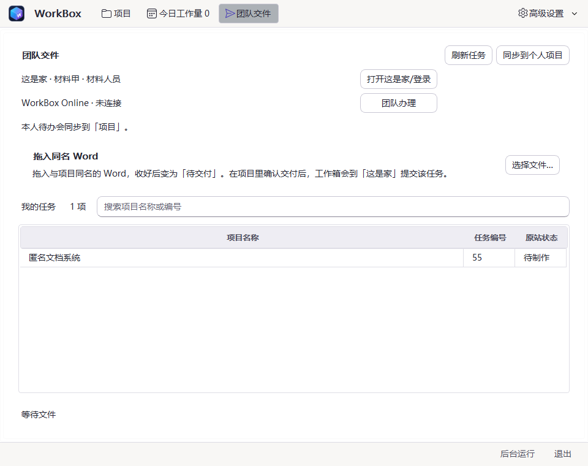

# WorkBox 团队交件

日常使用 WorkBox 工作箱和「这是家」。在工作箱顶部打开「团队交件」看我的待办，点「团队办理」即可在工作箱内操作办公室项目。只用浏览器的同事也可以沿用办公室网址。

| 谁操作 | 怎么做 |
| --- | --- |
| 分发者 | 在「团队办理」录入项目，一行一个可批量录入；分派手册、调优先级或改派。 |
| 手册人员 | 首次输入办公室地址，登录办公室，并在工具箱打开的「这是家」网页亲自登录。回到「我的待办」核对两个账号。将按项目全名命名的成品 Word 拖入工具箱，或从个人项目选「用此手册交件」。 |
| 手册交接 | 工具箱保存原件，向本人在办公室负责的同名手册项目交接，并用代码人员的取件入口读回原件。核对一致后，才在「这是家」为同一任务设置材料完成。结果分别显示办公室交接和原站提交。 |
| 代码人员 | 在「团队办理」领取代码/TXT，下载本次手册。上传代码 Word 和申请表 TXT，生成两份 Word、两份 PDF 和一份 TXT 的五件包。每份 PDF 上限 20,000,000 字节。 |
| 提交者 | 在「团队办理」下载五件包。实际对外提交成功后再登记「已向外部提交」。兼任代码或分发、手册职责时，使用同一个办公室账号。 |
| 统计 | 在「团队办理」查看有权限使用的进度和工作量统计。 |

两个系统的用户名可以不同，换号后重新核对。原站有同名待办时选择任务编号。遇到原站勾选了其他项目、已有弹窗或超时，请按提示核对同一任务。遇到办公室返工，进入「团队办理」查看打回说明并选择微调或重写。原件留底和办公室交接分开保存。

## 待办怎样更新

- 团队工作台的项目表和上传项目列表在前台约每 5 秒检查一次。分发后，手册人员能看到新增待办；手册交接后，代码人员能看到可领取的项目。一人领走后，其他代码人员的可领取列表会自动移除该项。填写交接表和选择文件时可以继续操作。
- 配置过团队工作台地址的电脑打开工作箱后进入「团队交件」。登录「这是家」后，工作箱约每 15 秒检查一次本人材料待办。可以切换页面或继续编辑，后台读取不会切换原站页面。需要自动提交时，请先结束原站编辑并清除其他项目的勾选。退出工作箱会关闭此次登录窗口，换号后按提示重新核对。

### 在个人项目中推进原站待办

1. 打开「团队交件 → 打开这是家/登录」，亲自登录材料账号。办公室账号未登录时，本人待制作、进行中和预审退回的任务会自动出现在个人「项目」里，新项目从「待开发」开始。也可以点「同步到个人项目」立即刷新。
2. 把按项目全名命名的成品 Word 拖入工作箱。文件收好后，项目变为「待交付」，原站暂时保留当前状态。同名任务按原站编号核对。
3. 在个人项目中点「确认交付」。本地归档完成后，工作箱会按登录账号和任务编号到「这是家」提交，并读回材料完成状态。原站只接收状态；Word 原件留在本机。如提示「原站待核对」，先检查原站同一编号的进度，再刷新待办。

重复同步会沿用同一编号已关联的个人项目，保留本机进度。需要把原件交给办公室同事时，从「团队办理」登录并核对两边账号，使用团队交件流程。

## 部署和数据

1. 办公室服务器安装「办公室服务器离线包」，在开始菜单打开「办公室服务器本机管理」，选择独立的数据目录完成首次配置。需要桌面工具箱的电脑安装「工作站离线包」。同一台电脑兼任两种用途就各装一份。仅通过浏览器办理办公室任务的成员可直接访问办公室网址。
2. 如需局域网访问，将监听 IPv4 设为服务器的局域网地址，如 `192.168.1.20`。若配置为 `0.0.0.0`，成员同样使用服务器实际局域网地址访问。默认网页端口为 `18770`，示例地址为 `http://192.168.1.20:18770/`。仅本机试用可选 `127.0.0.1`。由办公室管理员按需放行该网页端口。
3. 在「本机管理」选择启动。成员第一次点「打开团队工作台」时输入该网址。管理员和成员密码由使用者输入。
4. 个人项目沿用工作箱原有数据目录。「团队交件」显示本机手册留底的位置。团队材料、数据库和五件包存放在服务器实例数据目录。备份前先停止服务，再备份整个实例目录，同时保留相应版本的安装包。恢复时按备份时的程序版本、目录和配置恢复整份实例，再启动核对。
5. 已有办公室服务可以继续运行，成员更新工具箱时先退出自己的 WorkBox，再运行工作站离线包。要把旧统一安装版的服务器迁到独立包，先记录原程序版本、实例目录、监听地址和端口。在约好的停服时间用原「本机管理」停止服务并备份整个实例。安装办公室服务器离线包，在「办公室服务器本机管理」确认原目录，选择「6. 升级上一版统一实例」并输入「升级」。核对新目录后启动，检查原账号、材料和访问地址。同版本也按此流程迁移，再处理原安装。回退时先停止新实例，再用原版本选择保留的旧实例，另行保留切换后新增的业务记录。

## 源码对应

原桌面包含 WorkBox PR #132 的合并提交 `d1d87dce51701ea53a1fe69bba65579f20dfec77`。团队交件以库的方式接入主窗口，共用原桌面进程。服务器使用 WorkBox Online 在 `8cf3cd97dafe85675ba6e9cda7417f90c962d64c` 构建的 Kanboard/Filee 程序，其 `install-bundle.json` 的 SHA-256 为 `b55569cb672a1fa5654cc27831949da6d8333e3d69187056db0807612df767bd`。
