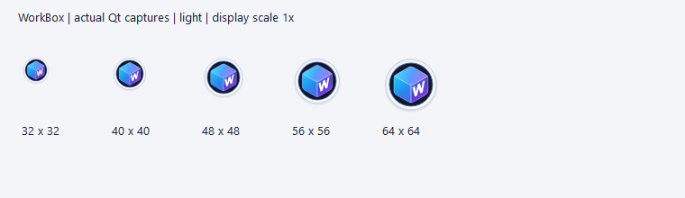
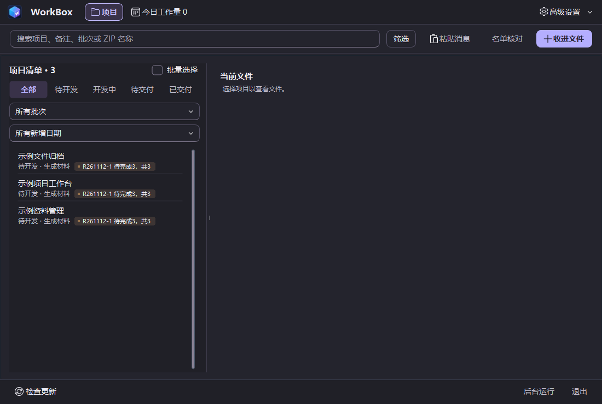
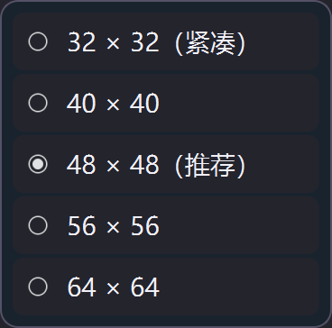

# WorkBox 立方工作台品牌

用户已选择视觉提案中推荐的 A「立方工作台」并授权接入最新代码。

## 设计约束

- 三面圆角立方体：青蓝顶面、蓝色左面、蓝紫右面，右面为独立白色 W 矢量，不依赖字体或外部图片。
- 应用、标题栏、托盘、工作台品牌及网站 favicon 由 `branding.py` 同源生成；保留 Windows ICO 的 16/24/32/48/64/128/256 七档原生帧，另支持 512px 品牌输出。
- 悬浮窗默认 48×48 Qt 逻辑像素。原生右键菜单可选 32（紧凑）、40、48、56、64；只保存本地显示偏好，不改变工作流设置。
- 默认、悬停、键盘焦点、拖入、运行中、项目计数都有独立反馈；改变外圈而非抖动点击区域。缩小模式保持完整辅助阅读计数，不把真实项目计数伪装成通知。
- 保留点击打开、拖动位置、文件/文字拖放、原生菜单、托盘与置顶恢复。尺寸变化仍约束在屏幕可用范围内。
- 浅色/深色环境均保持品牌对比；只改品牌和悬浮入口，不重做整个 Studio 工作台，不修改用户资料、数据库业务记录或发布版本。

## 取舍

采用单一矢量源，而非裁切提案中的位图；小尺寸保持清晰，安装包和运行时不会变成不同 Logo。原提案的流动 W、齿轮及层叠方案不采用。静止状态没有持续动画；运行进度仍由真实业务进度驱动。

## 验收

运行真实 Qt 渲染检查各图标尺寸、透明边角、完整 W、外圈与计数不遮挡中心；回归尺寸持久化、失败不切换、菜单同步、拖放与窗口恢复。截图仅使用隔离测试资料，另运行完整测试集及网站测试。源码验证不代表已安装或发布。

## 来源与版本对齐

本任务从实时获取的 `origin/main` 提交 `21d3e7eb58777b94eb74f2e53b63fef3bce6e098`
接续，包含 `20261112.2` 的批量加急修复及之前的 APP 名称识别修复。
发现本地 `main` 落后 10 个提交后，仅快速前进该引用，没有切换或覆盖未提交的品牌改动。
历史发布分支与旧工作树保留，不作为本次代码来源。

网页的页签、页头、页尾与说明页演示图标统一引用
`/favicon.svg?v=20261112-cube`，不再沿用旧缓存标识。此标识只表示品牌资源版本，
不是新的桌面安装包版本；旧下载目录、构建标签、媒体来源与正式数据均不改动。

## 可复现的验证

`python -m scripts.capture_cube_brand` 将实际 Qt 图标、五档悬浮入口、状态反馈、
原生尺寸菜单及匿名工作台截图输出到忽略的 `.local/cube-brand/captures/`。
只使用临时数据库，结束时清理匿名业务夹具，不读取已安装程序的数据库。
通过 `QT_QPA_PLATFORM=windows` 和 `QT_SCALE_FACTOR=1` / `2` 分别检查原生 1×、2× 渲染。
缩放测试仍在同一台 Windows 设备上，不代表第二台物理设备验收。

专项回归 69 项通过；原生 Windows 品牌回归 51 项通过；网站全量测试 145 项通过。
Qt 测试保留 QFluentWidgets 的 `QDomDocument.setContent` 弃用警告，不隐藏或算作零警告。
网页缓存回归先观察到 4 项失败，再更新页面引用后全部通过。

完整 Windows 桌面测试覆盖当前全部 189 个测试文件，共 **2874 通过、2 跳过、0 失败、0 错误**。
四个分组分别为 838、896、653、487 项通过；第二组另有 2 项真实 UNC 管理共享测试按环境配置跳过。
首个总控命令到达执行时限后保留已完成结果与中断日志，第三、四组单独完整重跑并确认退出码 0。
合计 5470 条测试警告，包括依赖弃用提示及 4 条 xunit2/record_property 提示；第三组退出时另有
48 个不可回收对象的 ResourceWarning。未将这些警告或未执行的环境验收描述为已消除。
仓库边界检查与差异空白检查均通过。

## 匿名实际截图

以下来自本次开发源码的真实 Qt 渲染，不是已发布安装包截图。所有项目均为脚本创建的匿名临时示例。
截图文件与本次源码一起审阅，历史发布页及原有媒体归属不变。

五档悬浮入口的等比例拼图，原生 1×：



深色工作台实际截图，原生 1×：



原生尺寸菜单，Qt 2× 缩放：



截图 SHA-256：

```text
4d20c0ee427b204ad75a36391ae94aac6df7b79453d5a271d90ca43a36808259  sizes-light.png
0fe37320b93976e15eb0ac85ecba2226822dee42e763094e95d4ecc48612e94c  workbench-dark.png
71d01b57ea9b4a5691b3cfb87375c47553009de59e56124458407af27c8eeb29  size-menu-dark-2x.png
```
