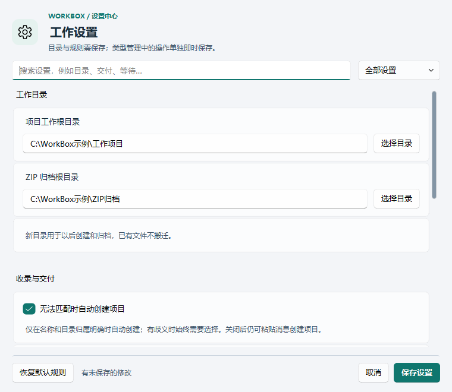
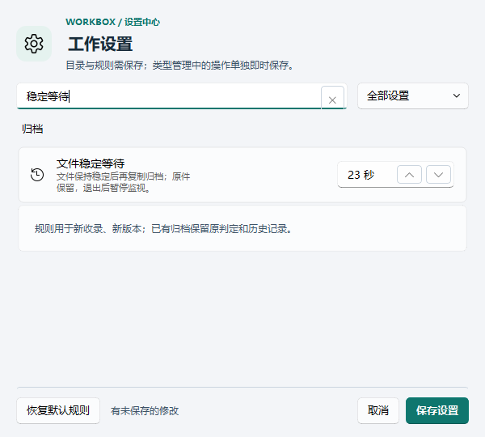
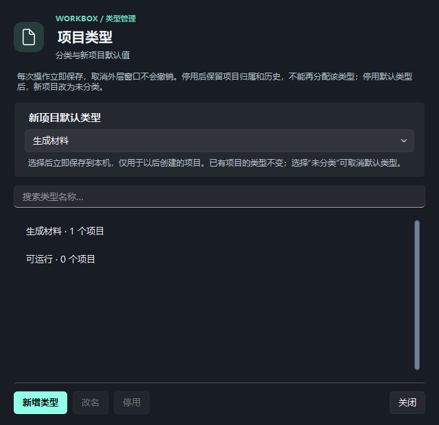

# 次级界面实拍样例

2026-11-03，真实 Windows Qt 源码运行，使用隔离匿名项目；不是生成式图片，不是已经安装的正式包截图。浅深主题由软件实际切换。截图中的 `C:\WorkBox示例` 是仅供显示的输入值，未保存、未创建目录，不是用户实际数据路径。

## 设置：可搜索、可定位、显式保存

## 小窗口：搜索后仍保留全部操作

## 类型管理：暗色、名称筛选与即时保存边界

源码验收另覆盖十个对话框及错误/空态，100%与125%缩放各28个实际截图状态。它不替代最终安装包的冻结程序验收或另一台物理设备测试。业务记录、设置在取消/只读检查之后保持不变。
