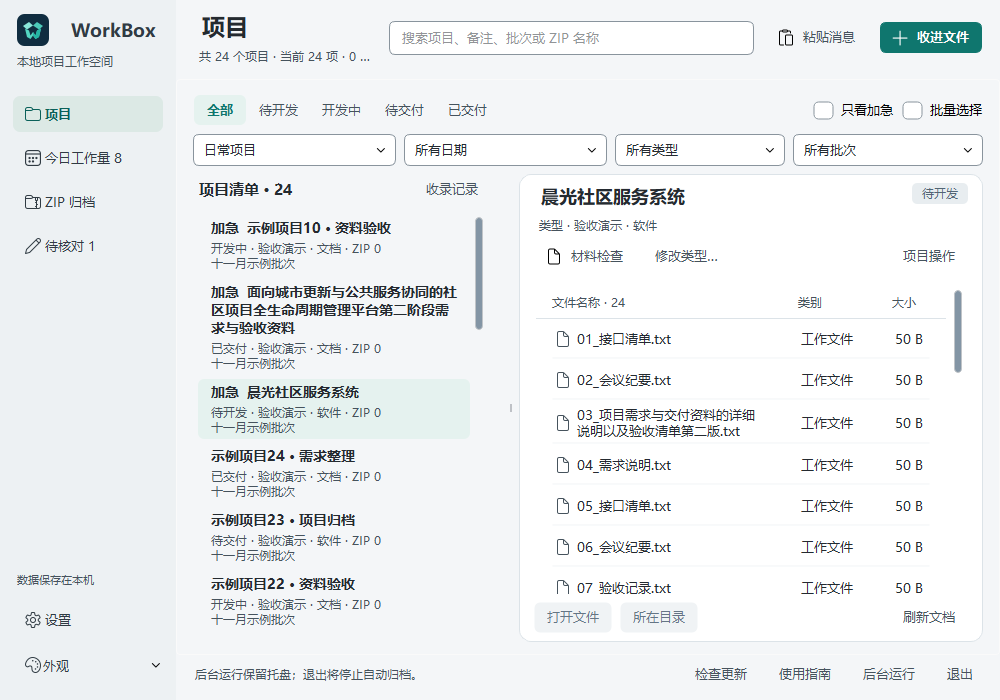
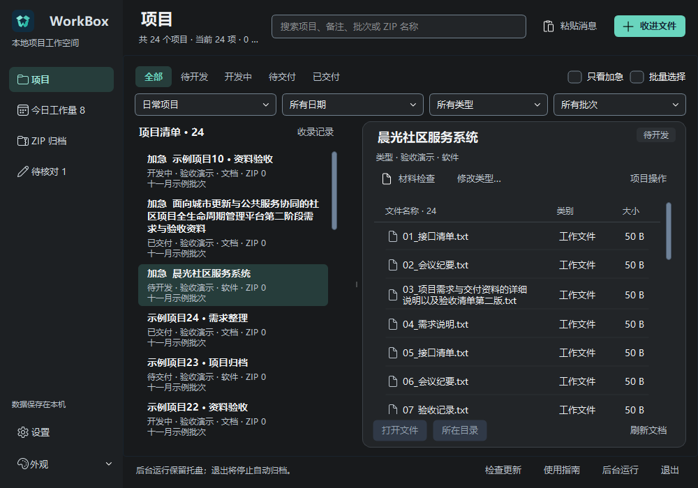
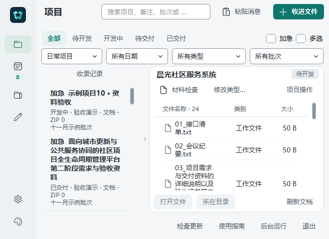

# 桌面控件与数据视图实拍

2026-11-04，真实 Windows Qt 源码窗口，使用 24 个匿名项目和每项目 24 个示例文件。图片来自 QWidget.grab()；不使用真实业务数据，也不是正式安装包截图。

浅色采用连续灰白工作区与白色文件面板；暗色采用中性炭灰。按钮、输入框、下拉框、状态筛选和复选框使用统一尺寸与状态样式。项目名称、元数据、文件行和表头有不同的排版层级；文件数量进入表头，长名称完整换行。

## 1000×700，同一分栏与列宽

## 660×480，紧凑布局

四项筛选、收文件、项目操作和文件操作仍可访问。窄窗中的完整长名称会占多行，不能把固定可见行数当作所有项目的保证。

## 验证边界

截图用于核对真实外观；选择、刷新锚点、列宽与分栏拖动、主题切换、日期和交付操作另行验证。独立代码审查发现的禁用勾选标记与旧导航选中态问题已有像素回归覆盖。

源码进入 main 不会自动更新已安装的软件。本轮由 UI 开发端提交，安装包及实际设备升级由发布端从包含这些变更的已审查 main 创建全新构建；既有发布资源保持不可变。
