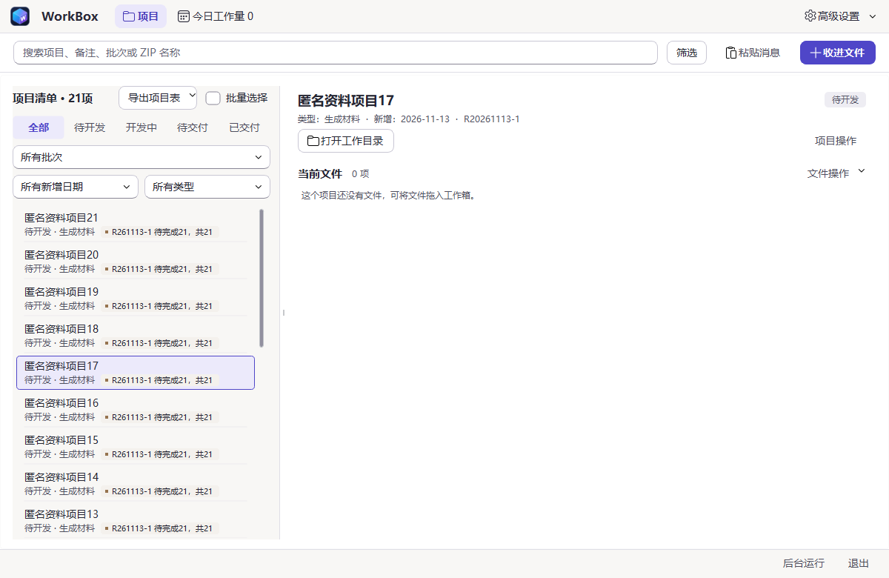
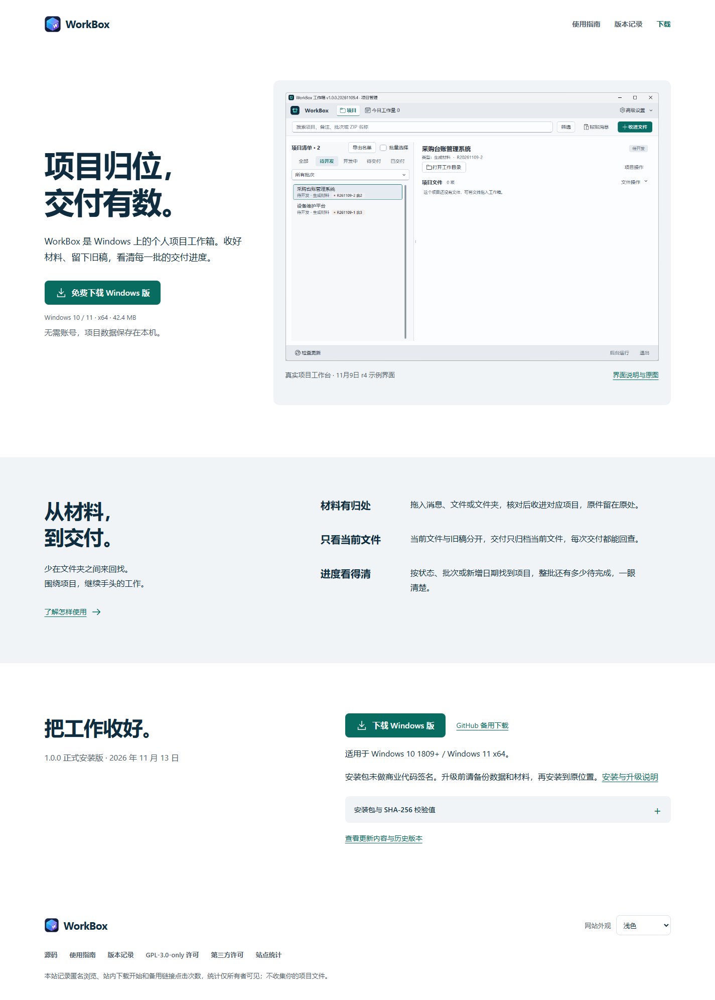

# 工作台入口与公开页面整理

截图对应源码提交 `70b19ce459ecf9a26fdc7b46c787ff1c258d1431`，使用匿名隔离数据和实际 Qt／浏览器渲染。它们用于审查本次改动，不代表已安装或已部署；官网内嵌产品图片仍明确标为原 r4 示例构建。

常用收件、项目筛选与导出继续直达。名单核对和检查更新进入按用途分组的原生高级菜单，忙碌取消、错误、筛选提示、后台运行与退出保留。README 改为简明入口，完整旧说明存档；版本页把完整说明与33个历史包分别折叠，下载身份不变。

## 实际界面

[查看官网手机布局](home-mobile.png)

## 验证范围

- Windows Qt 相关回归：77 通过，无跳过；691 条警告均为锁定 QFluentWidgets 的 QDomDocument 弃用提示。
- 网站：156 通过，无跳过；当前包、旧下载目录、媒体、更新、统计、无脚本和旧链接契约保留。
- 实际浏览器：38 项通过，覆盖1440／768／390宽度、浅深主题、键盘、历史折叠、校验复制、旧锚点、图片失败和无脚本系统深色。
- 独立审查：源码与实际截图通过；完整 Windows 回归及最终提交的 CI 状态以 Pull Request 检查结果为准。

测试只使用匿名临时数据库。初次并行夹具冲突及截图主题继承问题已修正并重新验证，不计入通过结果。没有改动正式数据库、原材料、交付事实、发布标签或安装包。

设计参考 [Things](https://culturedcode.com/things/) 和 [Obsidian](https://obsidian.md/) 对真实产品画面、简短用途和下载入口的组织；保留 WorkBox 品牌与原媒体出处。
