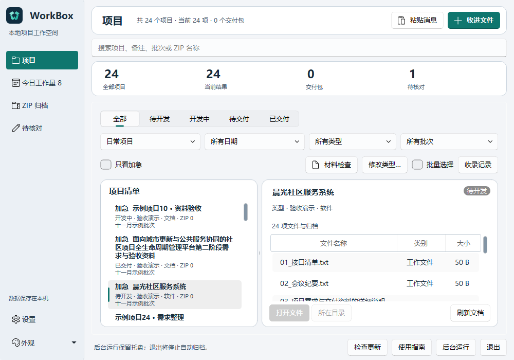
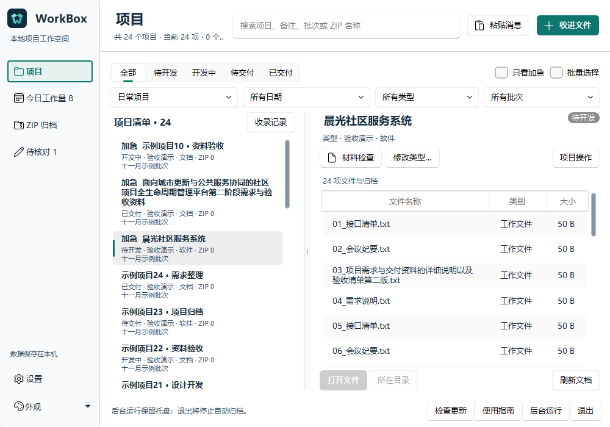
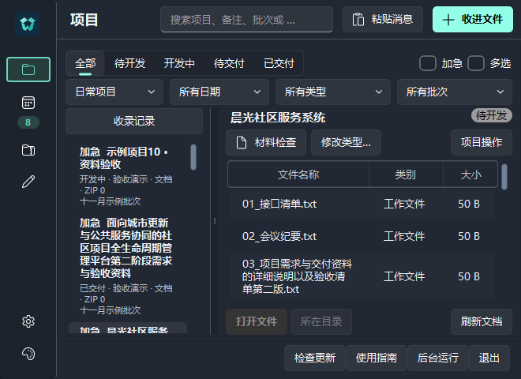

# 主项目工作台实拍对比

2026-11-04，真实 Windows Qt 源码窗口，使用固定的24个匿名项目和每项目24个示例文件。图片来自 QWidget.grab()，不是生成图，也不是正式安装包截图。不同名称的换行会影响完整可见行数。

## 同一1000×700窗口

改版前：基线提交 `12a656e7af166169ffc8db4b964295c72d4cfb80`。项目完整可见3行，文件2行。

改版后：本目录所在提交的主工作台实现。项目完整可见6行，文件6行；保留四项直接筛选、完整名称、项目操作、列宽和分栏拖动。

## 660×480暗色窗口

紧凑模式保留图标导航、收录记录、筛选和文件操作；选中图标使用与主题匹配的强调色。长名称继续完整换行。

截图不能替代日期保存/取消、文件读写、打包安装或另一台物理设备的行为验收。安装版需要从包含这些变更的已审查main另行构建和发布，现有发布资源保持不变。
